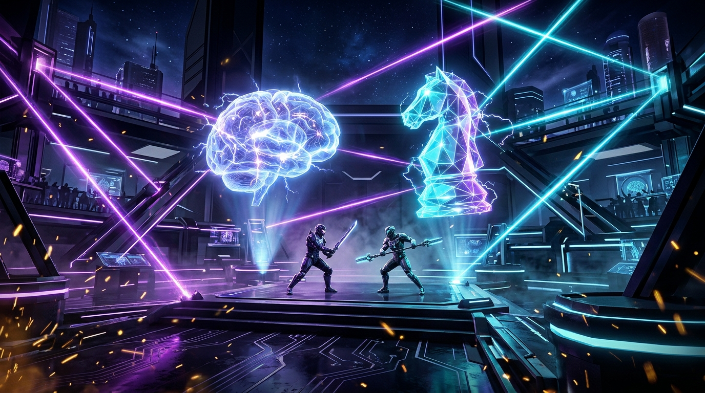
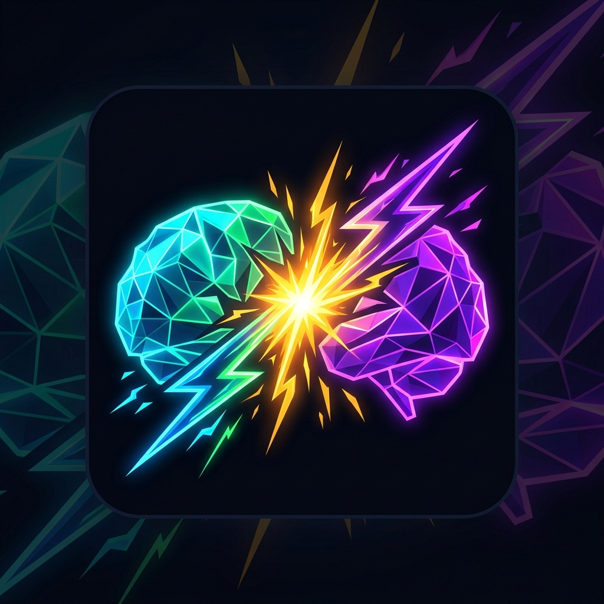

<p align="center">
  
</p>

<p align="center">
  
</p>

<h1 align="center">⚡ MindClash (صراع العقول)</h1>

<p align="center">
  <b>A real-time 1v1 psychological trivia showdown where knowledge meets cunning deception.</b>
</p>

<p align="center">
  <a href="https://flutter.dev"></a>
  <a href="https://dart.dev"></a>
  <a href="https://firebase.google.com"></a>
  <a href="https://bloclibrary.dev"></a>
  <a href="#clean-architecture"></a>
  <a href="LICENSE"></a>
</p>

---

## 📖 Table of Contents

- [Overview](#-overview)
- [Game Mechanics & Psychology](#-game-mechanics--psychology)
- [Key Features](#-key-features)
- [Design System & Theme](#-design-system--theme)
- [Clean Architecture & Project Structure](#-clean-architecture--project-structure)
- [Tech Stack & Dependencies](#-tech-stack--dependencies)
- [Getting Started](#-getting-started)
- [Question Bank & Seeding](#-question-bank--seeding)
- [Firebase Configuration](#-firebase-configuration)
- [Screens Overview](#-screens-overview)
- [Contributing](#-contributing)
- [License](#-license)

---

## 🎯 Overview

**MindClash** is a competitive two-player (1v1) mobile quiz duel built with **Flutter**, **Firebase Cloud Firestore**, and **Firebase Realtime Database**.

Unlike traditional trivia games that only test pure memorization, MindClash turns trivia into a psychological battle of wits. Each round, one player acts as **The Trapper** (*الخادع*) while the other acts as **The Answerer** (*المخمن*). The Trapper's goal is not merely to know the answer, but to invent deceitful, plausible fake choices to lure their opponent into a trap!

---

## 🧠 Game Mechanics & Psychology

Each match consists of **10 fast-paced rounds** with alternating roles between both competitors:

```mermaid
flowchart LR
    A[Lobby: 8-Digit Code] --> B[Round Start: 1 of 10]
    B --> C[Phase 1: Setting Traps<br/><i>Trapper (30s)</i>]
    C --> D[Phase 2: Answering Phase<br/><i>Answerer (30s)</i>]
    D --> E[Phase 3: Round Reveal<br/><i>Points Awarded (4s)</i>]
    E -->|Swap Roles| B
    E -->|After Round 10| F[Match Over: Victory Podium 🏆]
```

### 1. Phase 1: Setting the Traps (30s Timer)
* The **Trapper** is presented with the trivia question and the verified correct answer.
* The Trapper must write **two custom, convincing false answers** (*Traps* / *فخاخ*) crafted specifically to fool their rival.
* **Auto-Fallback**: If the Trapper fails to submit traps before the 30-second countdown expires, the game falls back into a 2-choice duel (1 correct answer + 1 system decoy).

### 2. Phase 2: The Duel / Answering (30s Timer)
* The **Answerer** is presented with the question and **4 shuffled choices**:
  * 🟢 **1 Correct Answer** (True trivia answer)
  * 🟣 **2 Trapper Traps** (Crafted by the rival)
  * ⚪ **1 System Decoy** (Predefined incorrect answer)
* The Answerer must deduce the correct answer under clock pressure while avoiding the rival's traps.

### 3. Phase 3: Round Resolution & Scoring (4s Cinematic)
* **Answerer identifies the Correct Answer:**
  * 🎯 **Answerer receives +1 Point.**
* **Answerer falls into the Trapper's Trap:**
  * ⚡ **Trapper receives +1 Point** for successful psychological deception!
* **Answerer picks the System Decoy / Times Out:**
  * ❌ **0 Points** awarded to either player.
* **Role Swap:** The players immediately switch roles for the next round.
* **Final Podium:** After Round 10, final scores are computed, triggering celebratory victory/defeat screens with real-time stats and rematch options.

---

## 🚀 Key Features

- **⚡ Real-Time Multiplayer Sync**: Seamless 1v1 state synchronization via Firebase Realtime Database with live countdown timers, answer streaming, and instant scoring.
- **🔢 8-Digit Battle Code Matchmaking**: Create private rooms instantly or join friends using lightweight numerical game codes.
- **🛡️ 10-Day Anti-Repeat Question Engine**:
  - Over **400+ curated trivia questions** loaded in Cloud Firestore.
  - Questions selected for a match are atomically locked with a `10-day availability cooldown` to prevent question repetition.
- **🎨 Cyberpunk / Neon Glassmorphic UI**: High-contrast, futuristic dark palette featuring *Void Canvas*, *Electric Violet*, *Hyper Emerald*, and *Solar Core* accents.
- **🌐 Bilingual & RTL Ready**: Native support for Arabic typography, custom digital countdown fonts, and responsive layout scaling.
- **🔒 Session & Auth Management**: Robust Firebase Authentication with full error handling, clean username assignment, and automatic session persistence.
- **📡 Resilient Connection Handling**: Real-time room status tracking with graceful exits, cleanup routines, and opponent-disconnect notifications.

---

## 🎨 Design System & Theme

MindClash uses a dark sci-fi aesthetic designed for high visual engagement:

| Token | Hex | Role |
| :--- | :--- | :--- |
| `voidCanvas` | `#09080E` | Main deep dark canvas background |
| `obsidianGlass` | `#12101F` | Elevated cards, dialogs, and containers |
| `elevatedSlate` | `#1B1830` | Top AppBars, navigation bars, bottom sheets |
| `electricViolet` | `#8B5CF6` | Primary brand accent & Trapper indicator |
| `hyperEmerald` | `#10B981` | Correct answers, ready states & victory signals |
| `solarCore` | `#FBBF24` | Active timers, battle codes & golden highlights |
| `cyberCrimson` | `#EF4444` | Timeouts, forfeits, and error states |
| `mintCyan` | `#34D399` | Secondary accent & lobby highlights |

---

## 🏗️ Clean Architecture & Project Structure

The project strictly follows **Clean Architecture** combined with the **BLoC/Cubit** pattern to ensure testability, maintainability, and clean separation of concerns.

```
lib/
├── core/                               # Cross-cutting concerns & shared utilities
│   ├── DI.dart                         # Service locator setup via GetIt
│   ├── errors/                         # Failures & Exceptions definitions
│   │   ├── exceptions.dart
│   │   └── failures.dart
│   ├── theme/                          # Design System
│   │   ├── app_colors.dart
│   │   ├── app_decorations.dart
│   │   └── app_text_styles.dart
│   ├── usecases/                       # Base UseCase contract
│   │   └── usecase.dart
│   ├── utils/                          # Validators & formatters
│   └── widgets/                        # Shared reusable widgets (e.g., MindClashLogo)
│
├── features/
│   ├── authentication/                 # Auth Feature (Login, SignUp, Session)
│   │   ├── data/                       # Datasources, Models, Repository Impl
│   │   ├── domain/                     # Entities, Repositories, Use Cases
│   │   └── presentations/              # AuthCubit, Login/Signup screens & widgets
│   │
│   ├── game_room/                      # Matchmaking & Waiting Room Feature
│   │   ├── data/                       # RTDB Datasource, Room & Player Models
│   │   ├── domain/                     # Room Entities, Matchmaking Use Cases
│   │   └── presentations/              # GameRoomCubit, RoomScreen, MindClashScreen
│   │
│   ├── game/                           # In-Game 1v1 Battle Arena Feature
│   │   ├── data/                       # Game Remote Datasource, Question Models
│   │   ├── domain/                     # Round & Question Entities, Battle Use Cases
│   │   └── presentations/              # GameCubit, GameScreen (Phases, Timers, Dialogs)
│   │
│   ├── home/                           # Main Arena Home Dashboard
│   └── splash/                         # Animated Launch Screen & Auth Router
│
├── firebase_options.dart               # Generated Firebase configuration
└── main.dart                           # Application entrypoint & MultiBlocProvider
```

### The Three Layers:
1. **Domain Layer (Core Logic)**: Completely independent of UI and third-party libraries (pure Dart). Contains `Entities`, `Repository Interfaces`, and single-responsibility `Use Cases`.
2. **Data Layer (Infrastructure)**: Implements repository interfaces, manages communication with Firebase Firestore & Realtime Database, and serializes `Models` to/from entities.
3. **Presentation Layer (UI & State)**: Powered by `flutter_bloc` (`Cubit`). Emits immutable states consumed by declarative Flutter widgets. Employs `dartz` (`Either<Failure, T>`) for functional error propagation.

---

## 🛠️ Tech Stack & Dependencies

| Category | Package | Version | Purpose |
| :--- | :--- | :--- | :--- |
| **Framework** | [Flutter SDK](https://flutter.dev) | `>=3.12.2` | Cross-platform UI toolkit |
| **State Management** | [flutter_bloc](https://pub.dev/packages/flutter_bloc) | `^9.1.1` | Predictable, unidirectional state management |
| **Dependency Injection** | [get_it](https://pub.dev/packages/get_it) | `^9.3.0` | Fast service locator for decoupling layers |
| **Functional Error Handling** | [dartz](https://pub.dev/packages/dartz) | `^0.10.1` | Functional `Either<Failure, Success>` programming |
| **Value Equality** | [equatable](https://pub.dev/packages/equatable) | `^2.0.7` | Value-based equality comparisons for states |
| **Auth Backend** | [firebase_auth](https://pub.dev/packages/firebase_auth) | `^6.7.0` | User authentication & credential management |
| **Database (Questions)** | [cloud_firestore](https://pub.dev/packages/cloud_firestore) | `^6.10.0` | Question bank & locking engine |
| **Database (Multiplayer)**| [firebase_database](https://pub.dev/packages/firebase_database) | `^12.6.0` | Realtime Database for live 1v1 gameplay sync |
| **Typography** | [google_fonts](https://pub.dev/packages/google_fonts) | `^8.2.1` | Typography & futuristic font styles |

---

## ⚡ Getting Started

### Prerequisites
- [Flutter SDK](https://docs.flutter.dev/get-started/install) installed (version `>=3.12.2`).
- [Dart SDK](https://dart.dev/get-dart) installed.
- A configured [Firebase Project](https://console.firebase.google.com/) with:
  - **Firebase Authentication** (Email/Password provider enabled).
  - **Cloud Firestore Database** (in production or test mode).
  - **Firebase Realtime Database** instance.

### 1. Clone the Repository
```bash
git clone https://github.com/your-username/mindclash.git
cd mindclash
```

### 2. Install Dependencies
```bash
flutter pub get
```

### 3. Setup Firebase
If configuring with your own Firebase project:
```bash
# Install FlutterFire CLI if you haven't already
dart pub global activate flutterfire_cli

# Configure your Flutter app with Firebase
flutterfire configure
```
Make sure `lib/firebase_options.dart` and `android/app/google-services.json` match your Firebase project credentials.

### 4. Run the Application
```bash
flutter run
```

---

## 🗄️ Question Bank & Seeding

MindClash includes a built-in verification and upload tool that populates Cloud Firestore with **400+ curated general knowledge and trivia questions** partitioned in `tool/questions_data_part[1-8].json`.

To seed your Firestore question collection, execute:

```bash
dart run tool/verify_and_upload_all_400.dart
```

Each question document contains:
```json
{
  "id": "1",
  "question": "ما هي عاصمة أستراليا؟",
  "correctAnswer": "كانبرا",
  "answers": ["سيدني", "ملبورن", "بيرث"],
  "availableAt": null,
  "lastUsedAt": null
}
```

When a match starts, 10 questions are selected and locked with `availableAt = now + 10 days`, guaranteeing fresh content across consecutive matches!

---

## 🔒 Firebase Configuration

### Realtime Database Security Rules (Reference)
```json
{
  "rules": {
    "rooms": {
      ".read": "auth != null",
      ".write": "auth != null"
    }
  }
}
```

### Cloud Firestore Security Rules (Reference)
```javascript
rules_version = '2';
service cloud.firestore {
  match /databases/{database}/documents {
    match /questions/{questionId} {
      allow read, write: if request.auth != null;
    }
  }
}
```

---

## 📱 Screens Overview

1. **Splash Screen (`/`)**: Animated cybernetic glow animation verifying authentication token and routing to Home or Login.
2. **Authentication (`/login`, `/signup`)**: Modern glassmorphic credentials forms with live validation and error handling.
3. **Home Arena (`/home`)**: Player profile header, live server status indicator, and direct entry card to the 1v1 battle arena.
4. **MindClash Hub (`/mindclash`)**: Choice between hosting a new game room or entering an existing 8-digit battle code.
5. **Waiting Room Lobby (`/room`)**: Live player presence, host badge, copyable game code, and interactive ready check.
6. **Battle Arena (`/game`)**:
   - **Trapper View**: Question preview, correct answer, and dual trap input fields with 30s countdown.
   - **Answerer View**: Live question and 4 randomized option cards with intuitive tap gestures.
   - **Cinematic Reveal**: Score animations, trap identity reveal, and transition banner.
   - **Podium & Results**: Final victory celebration, rematch button, and room exit.

---

## 🤝 Contributing

Contributions are welcome! If you'd like to improve MindClash:

1. **Fork** the project repository.
2. Create your feature branch (`git checkout -b feature/EpicFeature`).
3. Commit your changes (`git commit -m 'feat: Add epic new multiplayer feature'`).
4. Push to the branch (`git push origin feature/EpicFeature`).
5. Open a **Pull Request**.

---

## 📄 License

This project is open-source and licensed under the **MIT License**. See the [LICENSE](LICENSE) file for more information.

---

<p align="center">
  Crafted with passion for competitive minds ⚡ <b>MindClash</b>
</p>
